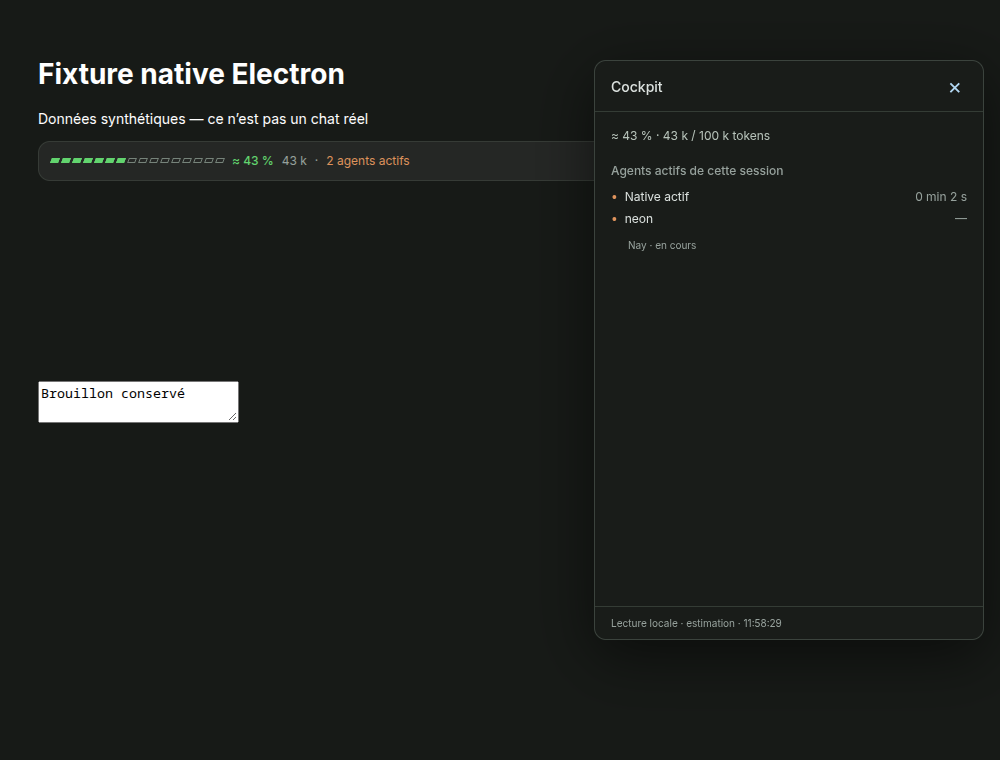

# Codex Cockpit

Une barre au-dessus du champ de saisie de **Codex Desktop**, pour voir uniquement :

- le contexte estimé de la session ouverte (tokens et pourcentage) ;
- ses sous-agents, leur nombre et leur état, accessibles par la flèche.

Le nombre total inclut les sous-agents terminés ; le nombre actif est indiqué séparément. La barre suit l’identifiant de la conversation ouverte. Aucun sélecteur de sessions, suivi de la session la plus récente, fichier, commande ou journal d’activité n’est affiché ni renvoyé par l’API.

Projet communautaire indépendant, sans affiliation avec OpenAI. **Version 0.3.1**.

## Installation native Linux

Prérequis : Python 3.9+, Codex Desktop `26.1027.30824` installé dans `/usr/lib/chatgpt`.

```bash
git clone https://github.com/PatLeGrand/codex-cockpit.git
cd codex-cockpit
python3 scripts/prepare-native.py --check
python3 scripts/prepare-native.py --destination "$PWD/../codex-cockpit-desktop"
```

Ferme complètement Codex, puis lance `../codex-cockpit-desktop/launch-cockpit`. La copie locale contient l’intégration native ; l’application d’origine reste disponible avec son lanceur habituel. L’activation dans le profil réel doit être vérifiée après relance. Le préparateur refuse les versions inconnues et les dossiers de destination existants.

Le mode natif utilise le runtime intégré à Codex et ne dépend d’aucun serveur web local. Voir [installation native](docs/native.md).



## Outils MCP et aperçu facultatifs

Le dépôt contient aussi un plugin MCP local pour consulter ces mêmes métriques. Ajoute le catalogue avec `codex plugin marketplace add PatLeGrand/codex-cockpit`, puis installe le plugin dans Codex Desktop. La compatibilité du catalogue dépend de la version de Codex.

Les outils `open_cockpit` et `cockpit_snapshot` exigent tous deux l’identifiant `session` du chat courant. Ils ne choisissent jamais une autre conversation par défaut. Le panneau web facultatif nécessite Node.js 22+ :

```bash
node src/cli.mjs --session ID_DE_LA_CONVERSATION
node src/cli.mjs --demo # aperçu explicitement signalé comme fictif
```

Si le service web s’arrête, rouvre le Cockpit depuis la conversation pour obtenir une nouvelle connexion. Cet arrêt n’affecte pas la barre native.

## Données et limites

Le contexte est estimé à partir de `last_token_usage.total_tokens / model_context_window`. Le cumul des tokens ne représente pas l’occupation du contexte. Les données absentes restent indisponibles.

Les sous-agents sont reliés par `parent_thread_id`, descendants inclus. Leur état provient des derniers événements de tour ; un état en cours sans événement depuis deux minutes est signalé comme non confirmé.

La lecture incrémentale concerne `$CODEX_HOME/sessions` (par défaut `~/.codex/sessions`), jusqu’à 160 journaux récents, avec actualisation toutes les deux secondes. Les formats paginés, distants ou modifiés par une mise à jour de Codex peuvent être incomplets.

Le plugin ne transmet rien à un service externe et n’expose ni prompts, ni noms de projets, ni chemins, ni appels d’outils. Le mode web protège les métriques par un jeton local éphémère. Ne partage pas son URL.

## Maintenance

`npm test` exécute les tests Node et Python. La CI vérifie Node 22 et 24. Voir [architecture](docs/architecture.md), [intégration native](docs/native.md) et [feuille de route](docs/roadmap.md). Rapporte les problèmes avec des exemples synthétiques, sans joindre tes journaux privés. Licence MIT.
